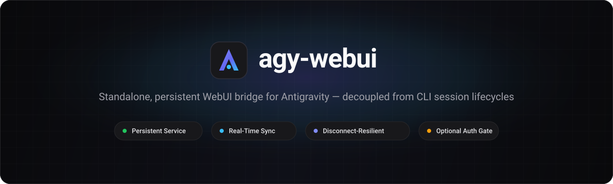
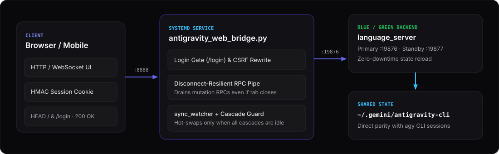

<div align="center">

<picture>
  <source media="(prefers-color-scheme: dark)" srcset="./assets/hero-dark.svg" />
  <source media="(prefers-color-scheme: light)" srcset="./assets/hero-light.svg" />
  
</picture>

<br />
<br />

[](./LICENSE)
[](./install.sh)
[](./antigravity_web_bridge.py)
[](https://github.com/abighozali/agy-webui)

<p>
  <a href="#why-agy-webui">Why agy-webui</a> ·
  <a href="#quick-start">Quick Start</a> ·
  <a href="#features">Features</a> ·
  <a href="#architecture">Architecture</a> ·
  <a href="#configuration">Configuration</a> ·
  <a href="#login-gate">Login Gate</a>
</p>

</div>

---

**`agy-webui`** turns Antigravity's built-in WebUI into a standalone, persistent `systemd` service on Linux. It shares state directly with `~/.gemini/antigravity-cli`, survives `agy` remote session exits, keeps active tasks running if your browser disconnects or backgrounds a tab, and ships an optional HMAC-signed login gate.

## Quick Start

```bash
git clone https://github.com/abighozali/agy-webui.git
cd agy-webui
./install.sh
```

Enable the password-protected `/login` gate during installation:

```bash
./install.sh --enable-login-gate
```

> [!NOTE]
> `install.sh` automatically detects `x86_64` or `arm64`, downloads the official Antigravity `language_server` and UI assets, writes `auth.env` (`0600`), and enables `antigravity-webui.service` under `systemd`.

<details>
<summary>Installer flags (<code>./install.sh --help</code>)</summary>

| Flag | Default | Description |
| --- | --- | --- |
| `--prefix DIR` | `/opt/antigravity` | Installation directory |
| `--host HOST` | `0.0.0.0` | Bridge bind address |
| `--port PORT` | `8888` | Public WebUI port |
| `--backend-port PORT` | `19876` | Internal `language_server` base port |
| `--app-data-dir NAME` | `antigravity-cli` | Folder name under `~/.gemini/` |
| `--enable-login-gate` | `off` | Enable `/login` gate with generated password |
| `--no-systemd` | `off` | Skip `systemd` unit installation |
| `--tarball-url URL` | auto-detected | Override official Antigravity bundle URL |

</details>

## Why agy-webui

| Capability | Ephemeral `agy` WebUI | `agy-webui` |
| --- | --- | --- |
| **Lifecycle** | Dies when `agy` remote session exits | Persistent `systemd` service (`antigravity-webui.service`) |
| **CLI State Sync** | Manual restart needed to see CLI updates | Blue-green `sync_watcher` hot-swaps automatically |
| **Client Disconnect / Tab Sleep** | Aborted streams or background kills | Mutation RPCs drain to EOF; active cascades block hot-swaps |
| **Remote Exposure** | Unauthenticated localhost server | Optional `/login` gate with HMAC-SHA256 `HttpOnly` cookies |
| **Health Probes** | `401` on gated `HEAD` probes | Unauthenticated `HEAD /` and `HEAD /login` return `200 OK` |

## Features

- **Persistent Standalone Service** — Decoupled from `agy` remote session lifecycles with automatic `systemd` restart on failure.
- **Direct CLI Storage & Real-Time Sync** — Reads and writes `~/.gemini/antigravity-cli` directly (zero file duplication) and reloads external `agy` changes via blue-green `language_server` hot-swaps.
- **Disconnect-Resilient Execution** — Drains mutation RPCs (`StartCascade`, `SendUserCascadeMessage`, `HandleCascadeUserInteraction`, etc.) to completion even if the browser closes or backgrounds the tab, and blocks hot-swaps while any cascade is running.
- **Full Chunked Streaming & OAuth Relay** — Rewrites `Host`/`Origin`/`Referer` headers cleanly and relays OAuth login flows via `/_bridge/start_login` and `/_bridge/poll_login`.
- **Toggleable Antigravity Login Gate** — Optional `/login` page matching the official Antigravity aesthetic, backed by `BRIDGE_AUTH_PASSWORD` and HMAC-SHA256 signed cookies.

## Architecture

<div align="center">
<picture>
  <source media="(prefers-color-scheme: dark)" srcset="./assets/arch-dark.svg" />
  <source media="(prefers-color-scheme: light)" srcset="./assets/arch-light.svg" />
  
</picture>
</div>

1. **Ingress & Auth Gate (`:8888`)** — Unauthenticated `HEAD /` and `HEAD /login` return `200 OK` for uptime probes; when `BRIDGE_LOGIN_GATE=1`, all other unauthenticated `GET` requests redirect to `/login` and RPCs return `401`.
2. **Disconnect-Resilient Pipe** — `pipe_response` keeps draining `language_server` responses to EOF on mutation RPCs even if the client socket drops, preventing mid-turn cancellations.
3. **Cascade-Aware `sync_watcher`** — Monitors `~/.gemini/antigravity-cli` (`*.db`, `*.db-wal`, `*.pb`, `jetbox_summaries_proto.pb`) and performs a zero-downtime blue-green swap between primary (`:19876`) and standby (`:19877`) only when `has_active_webui_cascade()` confirms no cascade is running.

## Configuration

All runtime options can be set via environment variables or `/opt/antigravity/auth.env`:

| Variable | Default | Description |
| --- | --- | --- |
| `BRIDGE_HOST` | `0.0.0.0` | Listen address for the WebUI bridge |
| `BRIDGE_PORT` | `8888` | Listen port for the WebUI bridge |
| `BACKEND_PORT` | `19876` | Base internal port for `language_server` (`+1` used for standby) |
| `ANTIGRAVITY_APP_DATA_DIR` | `antigravity-cli` | Directory name under `~/.gemini/` |
| `ANTIGRAVITY_CLI_DATA_DIR` | `~/.gemini/antigravity-cli` | Full path to Antigravity CLI state directory |
| `BRIDGE_SYNC_ENABLED` | `1` | Enable real-time `sync_watcher` hot-swaps (`1` or `0`) |
| `BRIDGE_LOGIN_GATE` | `0` | Enable `/login` authentication gate (`1` or `0`) |
| `BRIDGE_AUTH_PASSWORD` | `""` | Password required when `BRIDGE_LOGIN_GATE=1` |
| `BRIDGE_SESSION_SECRET` | random per-boot | HMAC-SHA256 signing key for `agy_gate_session` cookies |

## Login Gate

Copy or edit `/opt/antigravity/auth.env` (see [auth.env.example](./auth.env.example)):

```dotenv
BRIDGE_LOGIN_GATE=1
BRIDGE_AUTH_PASSWORD=your-strong-password
BRIDGE_SESSION_SECRET=your-64-char-hex-secret
```

Apply changes:

```bash
sudo systemctl restart antigravity-webui.service
```

> [!TIP]
> Set a persistent `BRIDGE_SESSION_SECRET` in `auth.env` so existing browser sessions remain valid across service restarts.

## Uninstall

```bash
./uninstall.sh
```

Removes `antigravity-webui.service` and `/opt/antigravity` while preserving your conversation history under `~/.gemini/`.

## Status & License

Actively maintained for Linux `x86_64` and `arm64`. Released under the [MIT License](./LICENSE).
